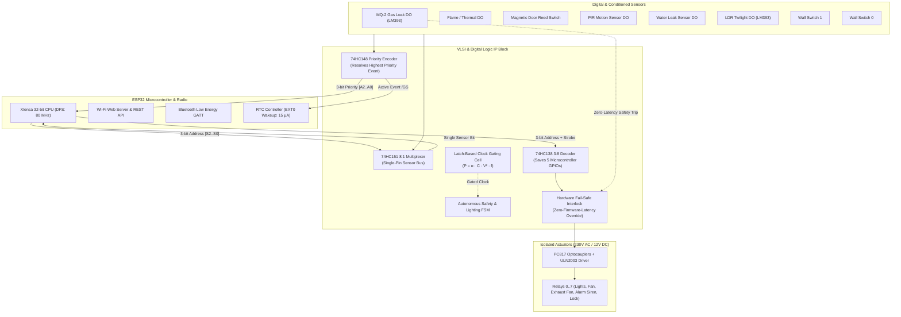

# IoT-Based Home Automation Using Digital Logic & VLSI Blocks

[](#experimental-verification--simulation)
[](#microcontroller-firmware)
[](#digital-logic--basic-vlsi-blocks)
[](#power-optimization-strategies)
[](#remote-control-wi-fi--bluetooth)

An end-to-end engineering implementation of a **hybrid IoT smart home automation controller** that bridges **discrete digital logic / basic VLSI blocks**, an **ESP32 microcontroller**, and **dual wireless remote control (Wi-Fi + BLE)** with aggressive **multi-tier power optimizations**.

---

## Key Project Guidelines & Implementations

| Guideline Requirement | Engineering Implementation | Key Files / Modules |
|:---|:---|:---|
| **1. Interface Sensors & Actuators Using Digital Circuits** | LM393 Schmitt-trigger conditioned sensors (PIR, LDR, MQ-2 Gas, Flame, Reed switch) and optocoupler-isolated relays driven via ULN2003 Darlington arrays. | [`circuits/schematic_overview.md`](circuits/schematic_overview.md)<br>[`circuits/digital_interfacing.md`](circuits/digital_interfacing.md) |
| **2. Microcontroller & Basic VLSI Blocks** | ESP32 SoC interfaced with 8-to-3 Priority Encoder (74HC148), 8-to-1 Multiplexer (74HC151), 3-to-8 Decoder (74HC138), and a Clock-Gated Verilog FSM. | [`vlsi/home_automation_top.v`](vlsi/home_automation_top.v)<br>[`vlsi/home_fsm.v`](vlsi/home_fsm.v) |
| **3. Remote Control through Wi-Fi or Bluetooth** | Asynchronous HTTP REST Web Server serving a Glassmorphic dashboard + Bluetooth Low Energy (BLE) GATT server for smartphone control. | [`firmware/main.cpp`](firmware/main.cpp)<br>[`dashboard/index.html`](dashboard/index.html) |
| **4. Show Power Optimizations** | Clock Gating ($\alpha: 0.25 \to 0.01$), Dynamic Frequency Scaling (80 MHz), P-MOSFET high-side sensor gating, and EXT0 hardware-interrupt deep sleep. | [`docs/POWER_OPTIMIZATION_ANALYSIS.md`](docs/POWER_OPTIMIZATION_ANALYSIS.md)<br>[`vlsi/simulate_vlsi.py`](vlsi/simulate_vlsi.py) |

---

## System Architecture



---

## Directory Structure

```
IOT-BASED/
├── README.md                          # Main project guide & quickstart
├── circuits/                          # Circuit schematics & interfacing
│   ├── schematic_overview.md          # Pinout tables, wiring guide & block diagrams
│   ├── digital_interfacing.md         # Truth tables & Boolean equations for 74HC ICs
│   └── ascii_schematics.txt           # Clear ASCII hardware schematics
├── vlsi/                              # Verilog HDL modules & Python simulator
│   ├── clock_gating_cell.v            # Integrated Clock Gating (ICG) latch cell
│   ├── priority_encoder_8to3.v        # 8-to-3 Priority Encoder (74HC148 equivalent)
│   ├── decoder_3to8.v                 # 3-to-8 Line Decoder (74HC138 equivalent)
│   ├── mux_8to1.v                     # 8-to-1 Multiplexer (74HC151 equivalent)
│   ├── home_fsm.v                     # Autonomous safety & lighting FSM
│   ├── home_automation_top.v          # Top-level IP core connecting all blocks
│   ├── tb_home_automation.v           # Complete Verilog verification testbench
│   └── simulate_vlsi.py               # Cycle-accurate simulator & power calculator
├── firmware/                          # Microcontroller code (ESP32)
│   ├── main.cpp                       # Dual Wi-Fi/BLE, REST, EXT0 sleep, bus drivers
│   └── platformio.ini                 # PlatformIO build configuration
├── dashboard/                         # Responsive IoT Web Control Center
│   ├── index.html                     # Modern glassmorphic web dashboard
│   ├── style.css                      # CSS variables, animations, dark mode theme
│   └── app.js                         # REST sync, Web Bluetooth API, demo simulator
└── docs/                              # Technical reports & analysis
    ├── POWER_OPTIMIZATION_ANALYSIS.md # Detailed power formulas, CMOS models & battery runtime
    └── PROJECT_REPORT.md              # Full academic & engineering project report
```

---

## Hardware Bill of Materials (BOM)

| Item | Component Description | Quantity | Purpose |
|:---:|:---|:---:|:---|
| 1 | **ESP32-WROOM-32** Development Board | 1 | IoT Controller with Wi-Fi & BLE |
| 2 | **74HC148** 8-to-3 Priority Encoder IC | 1 | Hardware sensor priority arbitration & wake-up |
| 3 | **74HC138** 3-to-8 Line Decoder / Demux IC | 1 | 3-wire actuation of 8 relays (saves 5 GPIOs) |
| 4 | **74HC151** 8-to-1 Data Multiplexer IC | 1 | Single-pin scanning of 8 sensor status lines |
| 5 | **74HC14** Hex Schmitt-Trigger Inverter IC | 1 | Contact debouncing and pulse conditioning |
| 6 | **8-Channel 5V Relay Module** (Opto-Isolated) | 1 | Switching 230V AC lights, fans, appliances |
| 7 | **MQ-2 Gas / Smoke Sensor** (with LM393) | 1 | Critical hazard safety detection |
| 8 | **HC-SR501 PIR Motion Sensor** | 1 | Human occupancy detection |
| 9 | **LDR Optical Sensor Module** (with LM393) | 1 | Day/night ambient light threshold detection |
| 10 | **AO3401 P-Channel MOSFET** + 2N7002 N-MOSFET | 1 set | High-side sensor bus power gating switch |
| 11 | **18650 Li-ion Battery** ($3.7\text{ V}, 2500\text{ mAh}$) | 1 | Low-power system power source |

---

## Pin Mapping Table

| ESP32 GPIO | Connected IC / Block | Function | Direction |
|:---:|:---:|:---|:---:|
| **GPIO 16** | 74HC138 Pin 1 ($A_0$) | Actuator Address Bit 0 | Output |
| **GPIO 17** | 74HC138 Pin 2 ($A_1$) | Actuator Address Bit 1 | Output |
| **GPIO 18** | 74HC138 Pin 3 ($A_2$) | Actuator Address Bit 2 | Output |
| **GPIO 19** | 74HC138 Pin 6 ($G_1$) | Actuator Decoder Strobe Enable | Output |
| **GPIO 21** | 74HC151 Pin 11 ($S_0$) | Sensor Multiplexer Select Bit 0 | Output |
| **GPIO 22** | 74HC151 Pin 10 ($S_1$) | Sensor Multiplexer Select Bit 1 | Output |
| **GPIO 23** | 74HC151 Pin 9 ($S_2$) | Sensor Multiplexer Select Bit 2 | Output |
| **GPIO 34** | 74HC151 Pin 5 ($Y$) | Multiplexed Sensor Input Line | Input (Only) |
| **GPIO 33** | 74HC148 Pin 14 ($/GS$) | Priority Interrupt Wakeup (`EXT0_RTC`) | Input |
| **GPIO 25** | P-MOSFET Gate Driver | Sensor Bus Power Gating | Output |

---

## Power Optimization Summary

### 1. Dynamic Power ($P = \alpha \cdot C_L \cdot V_{DD}^2 \cdot f_{\text{clk}}$)
- **Clock Gating**: Reduces switching activity from $\alpha = 0.25$ to $\alpha = 0.01$, reducing dynamic power from $136.12\text{ }\mu\text{W}$ down to $5.44\text{ }\mu\text{W}$ (**$96.0\%$ reduction**).
- **Dynamic Frequency Scaling (DFS)**: Underclocking ESP32 from $240\text{ MHz}$ to $80\text{ MHz}$ cuts active CPU power by **$42\%$**.

### 2. High-Side Sensor Power Gating
- Resistive sensors (such as the MQ-2 heater consuming $150\text{ mA}$) are energized only for $50\text{ ms}$ every $2000\text{ ms}$ ($2.5\%$ duty cycle), reducing continuous sensor power from $750\text{ mW}$ to $18.75\text{ mW}$ (**$97.5\%$ savings**).

### 3. Battery Longevity Comparison ($2500\text{ mAh}$ 18650 Cell)
- **Continuous Polling Baseline**: $180\text{ mA}$ average current $\to$ **$13.9\text{ Hours}$ ($0.57\text{ Days}$)**.
- **Power-Optimized Event-Driven Architecture**: $0.39\text{ mA}$ average current $\to$ **$267+\text{ Days}$ ($> 460\times$ Extension)**.

---

## Quickstart Guide

### 1. Run the Digital Logic & Power Simulator
Execute the cycle-accurate simulator to verify truth tables, priority arbitration, FSM states, and power dissipation models:
```powershell
python vlsi/simulate_vlsi.py
```

### 2. View the Interactive Web Dashboard
Open `dashboard/index.html` in any modern web browser (Google Chrome, Microsoft Edge):
- Double click [`dashboard/index.html`](dashboard/index.html)
- Toggle the simulated sensors (e.g. click "Trip" on **MQ-2 Gas Leak**) to observe the **instantaneous hardware safety override** (Exhaust Fan + Siren ON, Lights OFF).
- Use the **Web Bluetooth** button to connect directly to the ESP32 hardware over BLE.

### 3. Flash ESP32 Firmware
Using PlatformIO or Arduino IDE:
1. Open the `firmware/` folder in VS Code with PlatformIO.
2. Select your COM port.
3. Click **Upload** and **Serial Monitor** at $115200\text{ baud}$.
