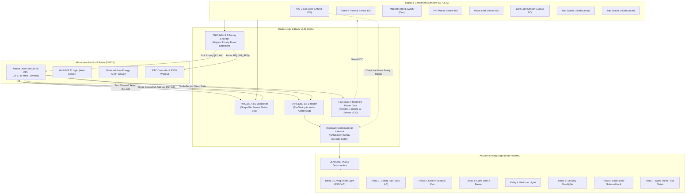

# Hardware Circuit Schematic & Interfacing Guide

## 1. System Block Diagram

---

## 2. Pin Mapping & Wiring Table

| Signal Name | ESP32 GPIO | Connected Digital Block / Pin | Description / Function |
|:---|:---:|:---|:---|
| `PIN_DEC_A0` | **GPIO 16** | 74HC138 Pin 1 ($A_0$) | Actuator Address Bit 0 |
| `PIN_DEC_A1` | **GPIO 17** | 74HC138 Pin 2 ($A_1$) | Actuator Address Bit 1 |
| `PIN_DEC_A2` | **GPIO 18** | 74HC138 Pin 3 ($A_2$) | Actuator Address Bit 2 |
| `PIN_DEC_EN` | **GPIO 19** | 74HC138 Pin 6 ($G_1$ Enable) | Active-High Actuator Enable Strobe |
| `PIN_MUX_S0` | **GPIO 21** | 74HC151 Pin 11 ($S_0$) | Sensor MUX Select Bit 0 |
| `PIN_MUX_S1` | **GPIO 22** | 74HC151 Pin 10 ($S_1$) | Sensor MUX Select Bit 1 |
| `PIN_MUX_S2` | **GPIO 23** | 74HC151 Pin 9 ($S_2$) | Sensor MUX Select Bit 2 |
| `PIN_MUX_SIG`| **GPIO 34** | 74HC151 Pin 5 ($Y$ Data Out) | Selected Sensor State (Input-Only Pin) |
| `PIN_PRIORITY_IRQ` | **GPIO 33** | 74HC148 Pin 14 ($/GS$ Group Select) | Hardware Wakeup Interrupt (`EXT0_RTC`) |
| `PIN_SENSOR_PWR_EN`| **GPIO 25** | P-MOSFET Gate (via 2N7002 driver) | High-Side Power Gating for Sensors |
| `PIN_ENC_A0` | **GPIO 32** | 74HC148 Pin 9 ($A_0$) | Priority Code Bit 0 |
| `PIN_ENC_A1` | **GPIO 35** | 74HC148 Pin 7 ($A_1$) | Priority Code Bit 1 |
| `PIN_ENC_A2` | **GPIO 39** | 74HC148 Pin 6 ($A_2$) | Priority Code Bit 2 (Input-Only RTC) |

---

## 3. Sensor Conditioning & Digital Interfacing

### 3.1 LDR Light Sensor (LM393 Schmitt Trigger Comparator)
- The LDR forms a voltage divider with a $10\text{ k}\Omega$ resistor.
- Fed into an LM393 dual comparator with a $100\text{ k}\Omega$ positive feedback resistor to introduce $50\text{ mV}$ of hysteresis (Schmitt trigger action).
- Eliminates oscillation/chatter when ambient sunlight transitions around twilight.
- Yields a clean, jitter-free 1-bit digital logic level:
  $$\text{V}_{\text{out}} = \begin{cases} 3.3\text{ V (Logic 1)}, & \text{Dark / Night} \\ 0\text{ V (Logic 0)}, & \text{Daylight} \end{cases}$$

### 3.2 MQ-2 Gas & Smoke Detector
- Internal tin dioxide ($\text{SnO}_2$) sensing layer heated to operating temperature.
- Onboard LM393 comparator outputs active-HIGH digital signal when gas concentration exceeds safe threshold ($> 300\text{ ppm}$ LPG/Propane).
- Directly wired to Priority Encoder input 7 (Highest Priority) AND routed to the hardware fail-safe AND/OR interlock gate.

### 3.3 Passive Infrared (PIR) Motion Sensor (HC-SR501)
- Digital output delivers $3.3\text{ V}$ pulse for $3\text{ s} - 5\text{ s}$ when thermal infrared fluctuation is detected.
- Conditioned through a 74HC14 Schmitt trigger inverter to eliminate false triggers caused by RF noise from Wi-Fi packet transmissions.

---

## 4. Actuator Driver & Isolation

- **Isolation**: Actuator relay coils are powered by a dedicated $+5\text{ V}$ DC supply rail. All control signals pass through **PC817 Optocouplers** with optical isolation barriers up to $5000\text{ V}_{\text{RMS}}$, protecting sensitive CMOS microcontrollers and VLSI chips from inductive back-EMF spikes.
- **Relay Drivers**: **ULN2003A** Darlington transistor arrays sink up to $500\text{ mA}$ per channel with built-in flyback suppression diodes connected to $+5\text{ V}$.
- **AC Mains Load**: High-grade Songle SPDT relays rated for $10\text{ A}$ @ $250\text{ V}_{\text{AC}}$ control the lights, exhaust fans, and auxiliary sockets.
